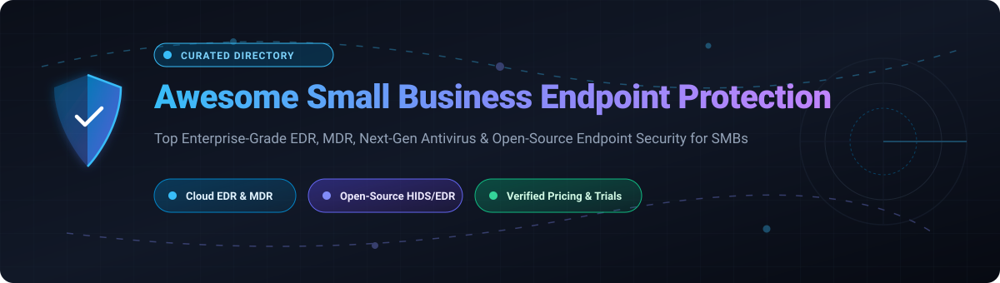

  

# 🛡️ Awesome Small Business Endpoint Protection

  
  
  
  
  
  
  

> 🚀 A curated directory of top-tier Small Business Endpoint Protection platforms, lightweight EDR (Endpoint Detection & Response), managed threat detection (MDR), and self-hosted open-source endpoint security tools for SMBs, IT generalists, and MSPs.

---

## 📑 Table of Contents

- [📊 Sector Overview & Market Dynamics](#-sector-overview--market-dynamics)
- [☁️ SaaS Products](#️-saas-products)
- [💻 Open-Source GitHub Projects](#-open-source-github-projects)
- [🧭 Buyer's Evaluation Guide for SMBs](#-buyers-evaluation-guide-for-smbs)
- [🤝 Support](#-support)
- [📈 Star History](#-star-history)
- [💡 How to Contribute](#-how-to-contribute)
- [⚠️ Disclaimer](#️-disclaimer)

---

## 📊 Sector Overview & Market Dynamics

The global **Endpoint Protection Platform (EPP)** and **Endpoint Detection and Response (EDR)** market is estimated at **$17 billion to $23 billion USD**, with forecasts projecting growth beyond **$40 billion USD** over the next decade. 

The sector exhibits a **two-tier market structure**: it is **moderately concentrated at the enterprise top tier**—where a handful of multi-billion-dollar platform giants (such as Microsoft and CrowdStrike) command substantial consolidated market share—yet remains **highly fragmented across the SMB, mid-market, and MSP channel landscapes**, where dozens of specialized vendors, managed detection services (MDR), and regional providers compete on price, agent footprint, and managed operations.

---

## ☁️ SaaS Products

The table below ranks leading SaaS endpoint protection platforms tailored for small and medium-sized businesses. Companies are sorted by size (**Market Capitalization / Company Valuation** descending).

| Product / Vendor | 🏢 Company Size (Market Cap / Valuation) | 💵 Pricing (Specific Starting Tier) | ⏳ Free Tier / Trial Limit | 🎯 Key Focus & Features |
| :--- | :--- | :--- | :--- | :--- |
| **[Microsoft Defender for Business](https://www.microsoft.com/en-us/security/business/microsoft-defender-business)** | ~$3.1T Market Cap (Microsoft NASDAQ: MSFT) | **$3.00/user/month** (annual commitment, covers up to 5 devices per user) | **30-day free trial** (up to 300 users, full EDR & automated remediation) | Enterprise-grade EDR and automated investigation designed specifically for SMBs with up to 300 seats. |
| **[CrowdStrike Falcon Go](https://www.crowdstrike.com/)** | ~$75B Market Cap (CrowdStrike NASDAQ: CRWD) | **$59.99/device/year** (or $7.99/device/month, max 100 devices) | **15-day free trial** (covers up to 100 devices with Falcon Prevent next-gen AV & USB control) | AI-powered next-gen antivirus and USB device control for lightweight SMB endpoint defense. |
| **[Avast Business](https://www.avast.com/business)** | ~$16B Market Cap (Gen Digital NASDAQ: GEN) | **$36.99/device/year** (Essential Business Security, 1–4 devices tier) | **30-day free trial** (full access across all business endpoints, no credit card required) | Essential next-gen antivirus, ransomware shield, data protection, and cloud management console. |
| **[Webroot Business Endpoint Protection](https://www.webroot.com/)** | ~$6.5B Market Cap (OpenText NASDAQ: OTEX) | **$150.00/year for 5 endpoints** (~$30.00/endpoint/year starting package) | **30-day free trial** (unlimited trial endpoints, includes full console access & multi-vector protection) | Ultra-lightweight cloud agent with predictive BrightCloud threat intelligence and automated rollback. |
| **[Trend Micro Worry-Free Services](https://www.trendmicro.com/)** | ~$5.5B Market Cap (Trend Micro TYO: 4704) | **$37.75/user/year** (Worry-Free Services Standard starting tier) | **30-day free trial** (valid for up to 25 devices/endpoints, full security suite access) | Cloud-managed endpoint and web threat security designed for lean IT teams and SMB environments. |
| **[SentinelOne Singularity Core](https://www.sentinelone.com/)** | ~$5.2B Market Cap (SentinelOne NYSE: S) | **$69.99/endpoint/year** (Singularity Core entry tier through authorized resellers) | **30-day Proof of Concept (PoC) trial** (available on request via sales/certified partners) | Autonomous AI behavioral engine offering real-time prevention, detection, and single-click remediation. |
| **[Sophos Intercept X](https://www.sophos.com/)** | ~$3.9B Valuation (Acquired by Thoma Bravo) | **$28.00/user/year** (Intercept X Advanced starting volume tier) | **30-day free trial** (full functionality across Windows and macOS endpoints via Sophos Central) | Deep learning neural network malware analysis, CryptoGuard anti-ransomware, and exploit prevention. |
| **[Huntress Managed EDR](https://www.huntress.com/)** | ~$1.55B Valuation (Series D Private Unicorn) | **$8.99/endpoint/month** (~$107.88/endpoint/year for small business tiers) | **21-day free trial** (unlimited endpoints, includes active 24/7 human SOC investigation and triage) | Turnkey Managed Detection and Response (MDR) backed by a 24/7 human threat-hunting SOC team. |
| **[Bitdefender GravityZone](https://www.bitdefender.com/)** | ~$600M+ Valuation (Vitruvian Partners Private Backed) | **$77.99/year for 3 devices** (~$26.00/device/year starting package) | **30-day free trial** (covers up to 100 endpoints, or 45-day trial for MSP partners) | Multi-layered machine learning protection, process inspector, behavioral monitoring, and anti-exploit. |
| **[Malwarebytes for Business](https://www.malwarebytes.com/)** | ~$650M Valuation (Vector Capital Private Backed) | **$69.99/device/year** (Malwarebytes for Teams starting tier) | **14-day free trial** (covers up to 20 endpoints, complete incident isolation and remediation) | Signature-less anomaly detection, behavioral ransomware mitigation, and fast automated cleanup. |

---

## 💻 Open-Source GitHub Projects

Open-source endpoint protection projects are sorted below by **GitHub Stars_Count (descending)**. Every repository badge links directly to its live GitHub Stargazers page.

| Project | ⭐ GitHub_Stars (Desc) | 🏷️ Category & Purpose | ⚙️ Key Capabilities | 🎯 Best Suited For |
| :--- | :--- | :--- | :--- | :--- |
| **[osquery](https://github.com/osquery/osquery)** |  | SQL-Powered Endpoint Instrumentation | Exposes the operating system as a high-performance relational database. Allows querying processes, open sockets, loaded kernel modules, and file modifications with simple SQL. | Teams seeking deep, low-overhead endpoint visibility and compliance auditing across Windows, Linux, and macOS. |
| **[Wazuh](https://github.com/wazuh/wazuh)** |  | Full EDR, XDR & SIEM Stack | Comprehensive platform offering File Integrity Monitoring (FIM), vulnerability detection, threat hunting, configuration assessment, and MITRE ATT&CK mapping. | Organizations with dedicated IT/security capacity wanting full enterprise-grade SIEM/EDR without software license costs. |
| **[ClamAV](https://github.com/Cisco-Talos/clamav)** |  | Antivirus Engine & Gateway Scanner | Multi-threaded scanner daemon, command-line utilities, automated signature database updater, and on-access scanning on Linux (ClamOnAcc). | Server-side and mail-gateway file scanning. Note: not a behavioral EDR replacement. |
| **[Fleet](https://github.com/fleetdm/fleet)** |  | Centralized Osquery & MDM Manager | Open-source device management server built on top of osquery. Provides real-time fleet queries, policy enforcement, vulnerability tracking, and remote script execution. | Small engineering-heavy teams needing centralized device visibility, vulnerability posture, and osquery management. |
| **[OSSEC](https://github.com/ossec/ossec-hids)** |  | Host-Based Intrusion Detection (HIDS) | Proven log analysis, registry auditing, rootkit detection, file integrity checking, and automated active response scripts. | Lightweight host intrusion detection on production Linux and Unix servers. |
| **[Velociraptor](https://github.com/Velocidex/velociraptor)** |  | Digital Forensics & Incident Response (DFIR) | Advanced endpoint forensics powered by VQL (Velociraptor Query Language), virtual file system (VFS) inspection, and offline evidence acquisition. | Rapid incident response, post-breach investigation, and ad-hoc endpoint threat hunting. |
| **[OpenEDR](https://github.com/ComodoSecurity/openedr)** |  | Open EDR & Telemetry Agent | Low-level kernel sensor, file system mini-filter, process and registry telemetry, and automated network containment upon detection. | Teams wanting a zero-licensing-cost EDR foundation with kernel-level tracking and threat containment. |
| **[CISA Logging Made Easy (LME)](https://github.com/cisagov/lme)** |  | SMB Turnkey Logging & Detection Stack | Government-vetted architecture combining Elastic Stack and Wazuh containerized with Podman for centralized telemetry and basic alerting. | Resource-constrained organizations needing a structured, free detection baseline without designing architecture from scratch. |
| **[BLUESPAWN](https://github.com/ION28/BLUESPAWN)** |  | Active Defense & EDR Sensor | Windows active defense client that detects suspicious behavior, validates endpoint security posture, and mitigates threats using MITRE ATT&CK mappings. | Windows system administrators and blue teams wanting local endpoint defense verification and suspicious activity blocking. |
| **[WHIDS](https://github.com/0xrawsec/whids)** |  | Windows Host IDS & EDR | Open-source HIDS/EDR for Windows based on Sysmon telemetry. Evaluates events against customizable detection rules in YAML. | Lightweight Windows host monitoring based on native Sysmon event pipelines. |
| **[Rustinel](https://github.com/Karib0u/rustinel)** |  | Lightweight Native Telemetry Sensor | Cross-platform endpoint detection written in Rust. Evaluates native telemetry directly with Sigma, YARA, and IOC rules without requiring cloud infrastructure. | High-performance, low-footprint endpoint monitoring on resource-limited hosts. |
| **[Radegast EDR](https://github.com/radegast-edr/radegast-console-backend)** |  | Privacy-First Encrypted EDR | Privacy-focused EDR backend utilizing age encryption (E2EE) so endpoint telemetry cannot be decrypted by unauthorized servers. | Privacy-sensitive small labs and teams wanting self-hosted telemetry without raw cloud logs. |

---

## 🧭 Buyer's Evaluation Guide for SMBs

When deciding between **Commercial SaaS** and **Open-Source Self-Hosted Solutions**, small business teams should evaluate three primary trade-offs:

1. 🧑‍💻 **Human Operations vs. Software Cost**:
   - Commercial MDR solutions like **Huntress** or enterprise suites like **Microsoft Defender for Business** include automated remediation or 24/7 human threat-hunting teams.
   - Open-source solutions like **Wazuh** or **OpenEDR** provide robust telemetry and detection engines, but **require in-house staff or an MSP** to triage alerts, tune false positives, and remediate compromises.
2. ⚡ **Agent Footprint & OS Coverage**:
   - Solutions like **Webroot** and **osquery** are celebrated for minimal CPU and RAM footprints.
   - Verify whether your fleet contains mixed OS environments (Windows, macOS, Linux distributions) before finalizing your tooling stack.
3. 🛠️ **Deployment Complexity**:
   - SaaS platforms can be rolled out across 50–300 devices in under an hour via standard MDM or single-installer scripts.
   - Open-source platforms like Wazuh or CISA LME require maintaining a central server cluster (Elasticsearch/OpenSearch indexer, dashboard, and management instances).

---

## 🤝 Support

If you find this curated resource helpful for securing your team, company, or home lab, please consider supporting the project:

- ⭐ **Star this repository** to help others discover it on GitHub.
- 🍴 **Fork and contribute** new endpoint protection tools, security updates, and pricing details.
- 📢 **Share this repo** on Twitter/X, LinkedIn, Reddit, or security Discord communities.
- ☕ **Buy a coffee / sponsor the project** via the official [GitHub Sponsors Dashboard](https://github.com/sponsors/ishandutta2007).

Your support keeps this guide independently maintained, up-to-date, and free forever! 🙌

---

## 📈 Star History

---

## 💡 How to Contribute

1. Fork this repository.
2. Add or update entries in `README.md` following the existing tabular structure.
3. Ensure pricing and trial specifications are concrete (avoid vague phrases such as *"Contact Sales"* or *"Free Trial Available"* without time limits).
4. For open-source tools, include the official GitHub repository and appropriate Stars_Badge format.
5. Submit a Pull Request with a clear description of the addition or revision.

---

## ⚠️ Disclaimer

- This curated list is maintained for educational and informational purposes; inclusion does not constitute a vendor endorsement.
- Pricing, trial periods, and market valuations fluctuate over time—always verify current terms on the official vendor websites.
- Self-hosted open-source security tools place 100% of the operational and incident remediation responsibility on the operator.
